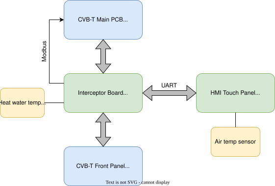
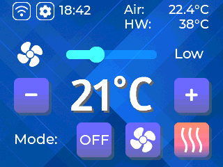

# Sabiana CVB-T Smart Heat Pump Integration Mod

This project modifies the Sabiana CVB-T convector to better integrate with intelligent heat pump systems, such as those from Nibe.

Modern heat pumps optimize energy use by only enabling the heating water supply line when heating is needed. However, the default CVB-T behavior does not detect this. It periodically starts up to check for hot water, regardless of whether any is available — leading to unnecessary fan operation and inefficiency.

## 🔧 Key Features

- **Intelligent Start Logic**  
  Heating only starts when hot water is available, so the unit follows the heat pump instead of waking up to check. This improves efficiency and reduces wear.

- **HMI Touch Interface**  
  A touch panel for monitoring and manual control. It can follow a weekly schedule, with separate settings for active and inactive hours, and an optional fan cycle that runs during active hours to reduce mould.

## 🛠️ Hardware Overview
This project introduces a small custom ESP-based PCB that plugs in between the Sabiana CVB-T main PCB and its front panel (which includes the status LEDs and IR receiver). This board acts as an interceptor and controller, enabling smarter control and communication with a new HMI touch panel over UART.

The interceptor board receives IR commands via the existing CVB-T IR receiver. It also controls the original CVB-T status LEDs and sends commands to the CVB-T using its Modbus interface.

## 📱 Panel

The gear icon opens the time program: week schedule, active settings, inactive settings, and fan cycle. Firmware build instructions are in [sw/README.md](sw/README.md).
