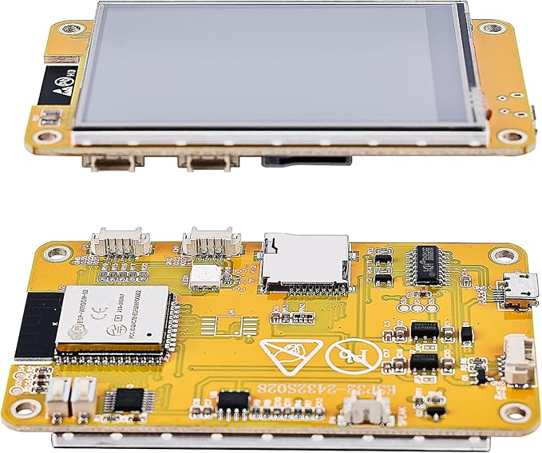
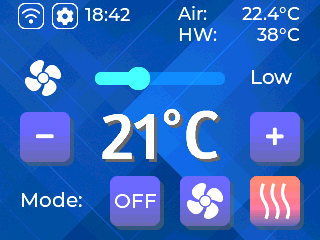
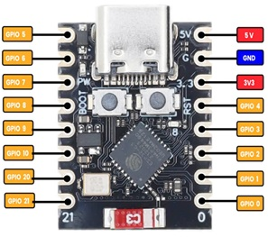

# Software

This dir contains the source code for the HMI and controller firmware. In order to build the two firmwares you need to install [platformio for vscode](https://platformio.org/install/ide?install=vscode).

## HMI Panel Software

The HMI panel uses a cheap ESP32 2.8" touch display like this:

The main screen:

The gear icon opens the time program: week schedule, active settings, inactive settings, and fan cycle. The Wi-Fi icon opens the network setup.

The one I used was called Vegana ESP32, but they are available as different brands.

The initialization code for the display originates from [ESP32-Cheap-Yellow-Display](https://github.com/witnessmenow/ESP32-Cheap-Yellow-Display) where you will also find lots of other useful things for this display.

### Building Firmware

Open the `hmi.code-workspace` in vscode. When PlatformIO initialization is done, press `CTRL+SHIFT+B` and select the task `PlatformIO: Build`.

## Controller Software

The controller board uses an ESP32-C3 SuperMini board like this:

The one I used was called Youmile ESP32-C3, but they are available as different brands.

### Building Firmware

Open the `controller.code-workspace` in vscode. When PlatformIO initialization is done, press `CTRL+SHIFT+B` and select the task `PlatformIO: Build`.

